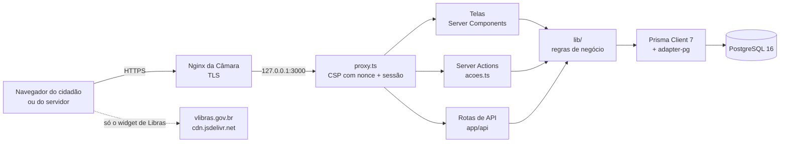

# Banco de Ideias Legislativas — Câmara Municipal do Recife

Sistema de participação popular (Resolução nº 2.690/2018): o cidadão apresenta
ideias legislativas, a Secretaria faz a triagem, os gabinetes analisam e adotam,
e qualquer pessoa consulta o acervo. Especificação técnica completa em
[`docs/Banco-de-Ideias-CMR-Especificacao-Tecnica.pdf`](docs/Banco-de-Ideias-CMR-Especificacao-Tecnica.pdf).

> O protótipo navegável de validação está em
> [`prototipo/banco-de-ideias.html`](prototipo/banco-de-ideias.html) (abre com duplo clique).

**Sumário:** [Visão geral](#visão-geral) · [Tecnologias e versões](#tecnologias-e-versões) ·
[Arquitetura](#arquitetura) · [Rodando pela primeira vez](#rodando-pela-primeira-vez) ·
[Produção](#produção) · [Comandos](#comandos) · [Problemas comuns](#problemas-comuns)

---

## Visão geral

O sistema substitui o recebimento informal de sugestões por um fluxo único, rastreável
e aberto ao público. Cada ideia recebe um **protocolo** (`BIL-AAAA-NNNNNN`) e percorre
estas situações:

```
RECEBIDA → EM_TRIAGEM → DISPONIVEL → EM_ANALISE → ADOTADA
                 └──────────┴────────────┴──────────┴──→ ARQUIVADA (com motivo)
```

Toda mudança de situação fica gravada numa trilha que o banco **não deixa alterar nem apagar**.
A mesma trilha alimenta a linha do tempo pública da ideia.

### Funcionalidades por perfil

| Perfil | Onde | O que faz |
|---|---|---|
| **Cidadão** (sem login) | `/participar` | Envia uma ideia em 4 passos (funciona até sem JavaScript) e recebe protocolo + código de acompanhamento |
| | `/consulta`, `/consulta/{protocolo}` | Consulta o acervo público (busca por texto, filtros por tema e situação, 10 por página) e **apoia** ideias (um apoio por CPF/CNPJ) |
| | `/acompanhar` | Acompanha a própria ideia com protocolo + CPF ou código, inclusive o motivo de arquivamento |
| | `/indicadores` | Vê os números do programa (ideias por tema, região, situação, tempo médio) |
| **Triagem** (Secretaria) | `/triagem` | Fila por prazo (15 dias úteis); assume, aprova, arquiva com motivo, corrige a redação (o original fica guardado) e revela o CPF quando necessário (registrado em auditoria) |
| **Gabinete** (vereadores) | `/gabinete` | Acervo ordenado por apoio; inicia análise, manifesta interesse junto com outros gabinetes, adota ou desiste |
| **Administração** | `/admin` | Usuários e perfis, temas e motivos de arquivamento, atendimento ao titular (LGPD: exportar e anonimizar), trilha de auditoria e exportação CSV |

Além das telas, o sistema publica **dados abertos** (`/api/dados-abertos`, JSON ou CSV)
sem nenhum dado pessoal.

### Privacidade (LGPD) em uma frase

Todo dado pessoal fica numa única tabela (`autor`); o CPF/CNPJ é guardado **cifrado** (AES-256-GCM)
e com um resumo (hash com "pepper") para busca. Nenhuma página pública, CSV ou log mostra CPF,
e-mail ou telefone.

---

## Tecnologias e versões

| Peça | Versão | Para que serve |
|---|---|---|
| **Node.js** | 22 | Ambiente de execução (imagem `node:22-bookworm-slim`) |
| **Next.js** | 16.4.3 (App Router) | Telas, Server Actions, rotas de API e o `proxy.ts` (sucessor do `middleware.ts`) |
| **React** | 19 (19.3.1) | Interface; `useActionState` nos formulários |
| **TypeScript** | 5.9 | Tipagem — **fixado**, ver [Problemas comuns](#prisma-8-e-typescript-7-quebram-o-projeto) |
| **Prisma** | 7.10 | ORM e migrações; conecta via driver adapter `@prisma/adapter-pg` — **fixado** |
| **PostgreSQL** | 16 | Banco de dados (`postgres:16-alpine` no Docker) |
| **Tailwind CSS** | 4 (4.3.3) | Estilos; sem `tailwind.config.ts`, os tokens ficam em `app/globals.css` |
| shadcn/ui + Base UI | — | Componentes base acessíveis em `components/ui/` |
| Zod | 4.6 | Validação dos dados que chegam ao servidor |
| jose | 6 | Cookie de sessão assinado (roda no Edge, dentro do `proxy.ts`) |
| @node-rs/argon2 | 2 | Hash das senhas do painel (argon2id) |
| Vitest | 5 | Testes unitários (`*.test.ts` ao lado do código) |
| ESLint | 10 | Lint (`eslint-config-next`) |
| Docker + Compose | — | Implantação (`Dockerfile` multi-estágio e `docker-compose.yml`) |

---

## Arquitetura

### Como as peças conversam



1. **Navegador → Nginx → Next.** O Nginx da Câmara faz o TLS e repassa para a aplicação, que só
   escuta em `127.0.0.1:3000`. Modelos prontos em `nginx/`.
2. **`proxy.ts`** roda antes de toda página: gera o *nonce* da Content Security Policy e, nas rotas
   `/triagem`, `/gabinete` e `/admin`, exige sessão válida (sem sessão → `/login`).
3. **Leitura de dados:** as páginas são Server Components. Elas chamam funções de `lib/` direto no
   servidor; nenhum dado vai para o navegador sem passar pelos tipos públicos de `types/publico.ts`
   (que não têm campo de dado pessoal).
4. **Escrita de dados — Server Actions:** cada tela com formulário tem um `acoes.ts` (`"use server"`).
   O `<form>` funciona mesmo sem JavaScript. Toda ação confere sessão e perfil **por conta própria**,
   porque uma Server Action aceita POST direto.
5. **Rotas de API (`app/api`)** expõem as mesmas regras em JSON para integrações, dados abertos e o
   monitoramento. Tela e API chamam **a mesma função** de `lib/`. Exemplo: `/participar` e
   `POST /api/ideias` usam `cadastrarIdeia()`.
6. **`lib/` → Prisma → PostgreSQL.** Toda mudança de situação passa por `lib/tramitacao/`, que confere
   o grafo de estados e o perfil em `maquina-status.ts`. A gravação usa controle de versão: se dois
   servidores clicarem ao mesmo tempo, o segundo recebe 409 em vez de sobrescrever.
7. **Banco como última barreira:** um gatilho (migração `..._tramitacao_append_only`) recusa
   `UPDATE`/`DELETE` na tabela `tramitacao`. Restrições `UNIQUE` garantem um apoio por documento.

O **único recurso externo** carregado pelo navegador é o VLibras (tradutor de Libras do Governo
Federal, obrigatório por acessibilidade). Fontes, ícones e estilos ficam no próprio repositório.

### Estrutura de pastas

```
app/
  (pages)/
    (publico)/          telas sem login: início, participar, consulta, acompanhar, indicadores   (Pessoa A)
    (painel)/           login, triagem, gabinete, admin  — cada uma com page.tsx + acoes.ts     (Pessoa B)
      _componentes/     peças compartilhadas do painel (ficha da ideia, navegação)
  api/                  rotas de API (ver tabela abaixo)
  fontes/               Lexend e Source Sans 3 em .woff2 (sem Google Fonts)
  layout.tsx            layout raiz: fontes, nonce da CSP e VLibras
  globals.css           tokens de cor e tipografia (Tailwind 4, @theme)
components/
  layout/               cabeçalho, rodapé, navegação pública, VLibras
  ui/                   componentes em português (Botao, Campo, Tabela...) sobre os do shadcn
lib/
  ideias/               cadastro, protocolo, consulta pública, apoio, acompanhamento, dados abertos
  tramitacao/           máquina de estados e mudança de situação
  painel/               consultas e ações do painel, prazo da triagem, administração, titular (LGPD)
  seguranca/            sessão, login, senha, CSP, CSRF (origem), limite de taxa, cifra do CPF, auditoria
  indicadores/          números agregados do programa
  regioes/              bairros e RPAs do Recife
  sistema/              instância do Prisma, montagem de URLs (basePath), utilitários
  verificacao/          verificador de acentuação dos textos das telas
prisma/
  schema.prisma         modelo de dados                                                          (Pessoa B)
  migrations/           migrações SQL (inclui o gatilho append-only)
  seed.ts               dados fictícios para desenvolvimento — nunca em produção
  gen/                  Prisma Client gerado (fora do Git; npm run db:generate)
types/publico.ts        contrato de dados públicos, sem dado pessoal                             (Pessoa A)
proxy.ts                CSP + proteção das rotas do painel
next.config.ts          basePath, saída standalone e cabeçalhos de segurança fixos
prisma7.config.ts       configuração do Prisma 7 (URL do banco e comando de seed)
nginx/                  subdominio.conf e proxy-portal.conf (os 2 cenários de integração)
docs/                   especificação, guia de front-end e guias de implantação
Dockerfile              imagem de produção (multi-estágio, sem root)
docker-compose.yml      produção: banco + migração + aplicação
docker-compose.dev.yml  desenvolvimento: só o PostgreSQL, na porta 5433
```

### Rotas de API

| Método e rota | Quem usa | O que faz |
|---|---|---|
| `POST /api/ideias` | público | Cadastra ideia (exige cabeçalho `Idempotency-Key`) |
| `GET /api/ideias/{protocolo}` | público | Detalhe público da ideia |
| `POST /api/ideias/{protocolo}/apoiar` | público | Registra apoio (um por CPF/CNPJ) |
| `POST /api/acompanhar` | autor | Situação da própria ideia (CPF vai no corpo, nunca na URL) |
| `GET /api/indicadores` | público | Números agregados |
| `GET /api/dados-abertos[?formato=csv]` | público | Acervo sem dado pessoal (LAI) |
| `GET /api/health` | TI / Docker | `200 {"status":"ok"}` ou `503` se o banco cair |
| `POST /api/ideias/{protocolo}/tramitar` | Triagem, Gabinete, Admin | Muda a situação (com `versao` para evitar conflito) |
| `POST /api/ideias/{protocolo}/revelar-documento` | Triagem, Admin | Mostra o CPF/CNPJ — registrado na auditoria antes da resposta |
| `GET /api/painel/exportar` | Triagem, Admin | CSV das ideias, sem dado pessoal |
| `POST /api/painel/titular/exportar` | Admin | JSON com os dados de um titular (LGPD, art. 18) |

### Integração com o portal

O mesmo código roda em dois endereços, trocando só `NEXT_PUBLIC_BASE_PATH` no build:
subdomínio próprio (recomendado) ou pasta dentro do portal da Câmara. Por isso nenhum link usa caminho
fixo começando com `/`. Detalhes em [`docs/implantacao/integracao-portal.md`](docs/implantacao/integracao-portal.md).

---

## Pré-requisitos

- **Node.js 22+** e npm
- **PostgreSQL 16**, de uma das duas formas:
  - Docker: `docker compose -f docker-compose.dev.yml up -d` (sobe um Postgres 16 na porta **5433**), ou
  - PostgreSQL já instalado na máquina (porta 5432)

## Rodando pela primeira vez

```bash
# 1. dependências (use "ci": respeita as versões fixadas no package-lock.json)
npm ci

# 2. variáveis de ambiente
cp .env.example .env
#    edite o .env (instruções dentro dele, no bloco DESENVOLVIMENTO do final):
#    - DATABASE_URL conforme seu Postgres (Docker = porta 5433, host localhost)
#    - gere as três chaves:
node -e "console.log('DOCUMENTO_CHAVE=' + require('crypto').randomBytes(32).toString('base64'))"
node -e "console.log('DOCUMENTO_PEPPER=' + require('crypto').randomBytes(32).toString('base64'))"
node -e "console.log('AUTH_SECRET=' + require('crypto').randomBytes(32).toString('base64'))"

# 3. banco: gera o Prisma Client, aplica as migrações e carrega dados fictícios
npm run db:generate
npm run db:migrate
npm run db:seed

# 4. sobe o sistema
npm run dev          # http://localhost:3000
```

Confira: `http://localhost:3000/consulta` deve listar as ideias de exemplo.

## Painel interno

Entre em `http://localhost:3000/login` com um dos usuários do seed (senha **`banco-ideias-2026`**,
só de desenvolvimento):

| Usuário | Perfil | Vai para |
|---|---|---|
| `triagem@exemplo.gov.br` | Secretaria · Triagem | `/triagem` — fila, aprovar, arquivar, revelar CPF |
| `gabinete@exemplo.gov.br` | Gabinete (Gabinete Ver. Teste) | `/gabinete` — acervo, analisar, adotar |
| `admin@exemplo.gov.br` | Administração | `/admin` — usuários, listas, LGPD, auditoria, CSV |

Para o **Acompanhar**: protocolo `BIL-2026-000006` + CPF `258.036.914-70` (ideia arquivada, mostra o motivo),
ou `BIL-2026-000001` + `529.982.247-25`.

## Produção

Imagem Docker multi-estágio (`Dockerfile`) e implantação em `docker-compose.yml`.
Passo a passo para a TI (do servidor limpo ao sistema no ar, além de operação, backup e
atualização) em [`docs/implantacao/guia-ti.md`](docs/implantacao/guia-ti.md).
O CI (`.github/workflows/ci.yml`) roda tipos, lint, testes, build, um teste de fumaça com PostgreSQL
real, `npm audit`, varredura de segredos e sobe o `docker-compose.yml` de verdade, testando o
sistema dentro do contêiner.

## Comandos

| Comando | O que faz |
|---|---|
| `npm run dev` | Sobe o Next em desenvolvimento |
| `npm run verificar` | **typecheck + lint + testes** — é o nosso "pronto" |
| `npm run build` | Build de produção |
| `npm run db:generate` | Gera o Prisma Client em `prisma/gen/` |
| `npm run db:migrate` | Aplica migrações no banco do `.env` |
| `npm run db:seed` | Carga de dados fictícios |
| `npm run db:studio` | Inspeciona o banco no navegador |
| `npm run db:reset` | **Apaga** e recria o banco com as migrações + seed |
| `npm run admin:criar` | Cria um administrador do painel (com `--redefinir`, recupera o acesso) |

## Organização

Divisão de trabalho e regras da dupla em [`CONTRIBUTING.md`](CONTRIBUTING.md).
Regras e padrões do front-end (leitura obrigatória antes de alterar telas) em
[`docs/frontend.md`](docs/frontend.md).

## Problemas comuns

Erros conhecidos de implantação e de desenvolvimento, com sintoma, causa e solução, ficam na
[seção 6 do guia de implantação](docs/implantacao/guia-ti.md#6-problemas-comuns).

### Prisma 8 e TypeScript 7 quebram o projeto

O `latest` do npm hoje traz **Prisma 8 (release candidate)** e **TypeScript 7**, que ainda
quebram parte do ecossistema (o `typescript-eslint` não suporta TS 7). Por isso o projeto
fixa **Prisma 7.10** e **TypeScript 5.9**, versões estáveis e compatíveis.

- Não rode `npm i prisma@latest` mesmo que o Prisma sugira no terminal ("Update available").
- Pull requests automáticos do Dependabot que subam essas duas peças de versão principal
  devem ficar parados até o ecossistema acompanhar.
- Qualquer troca de versão só entra com `npm run verificar` passando.
